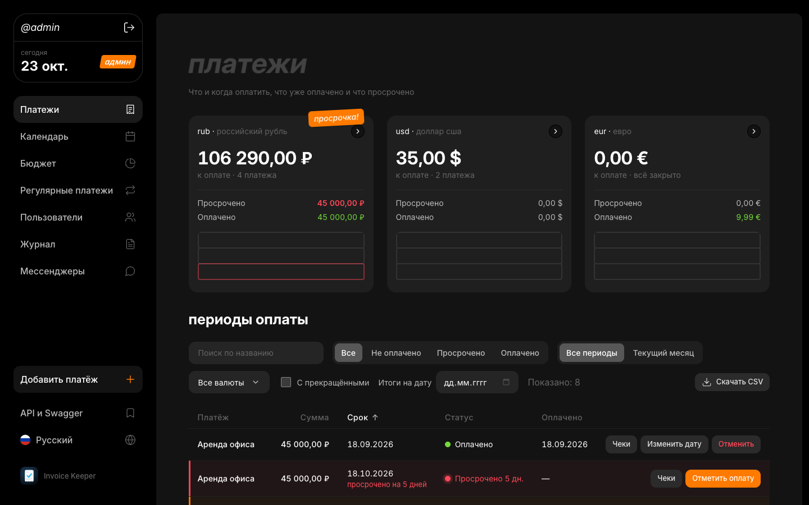
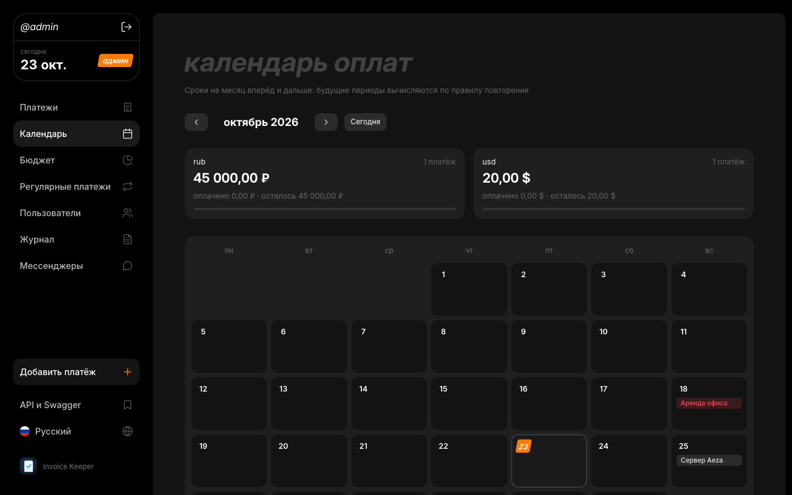
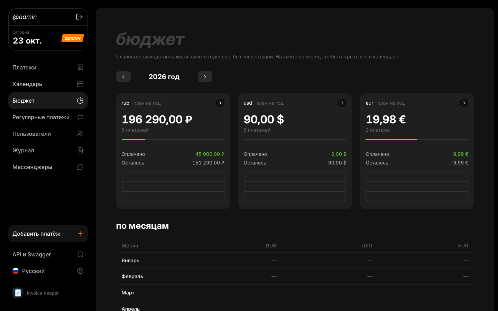
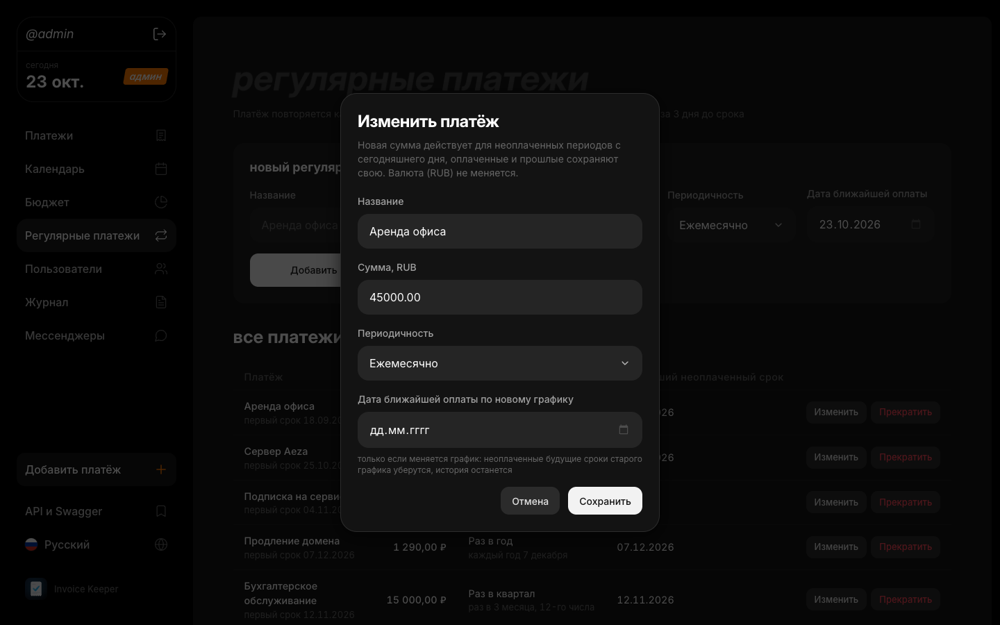
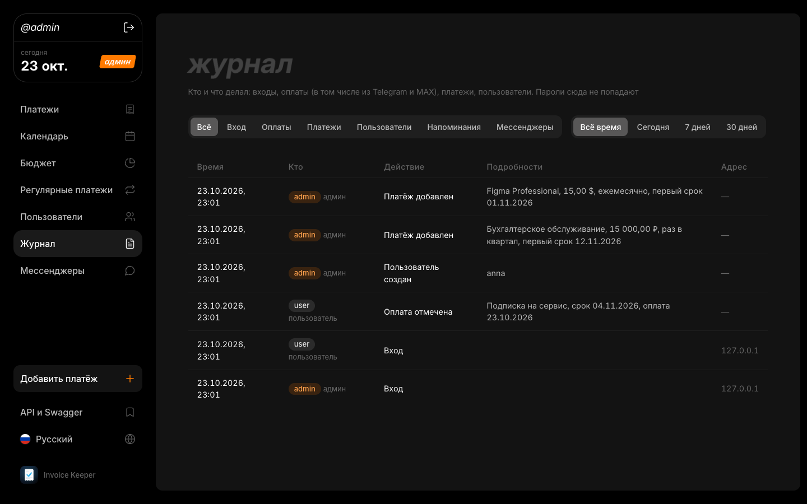
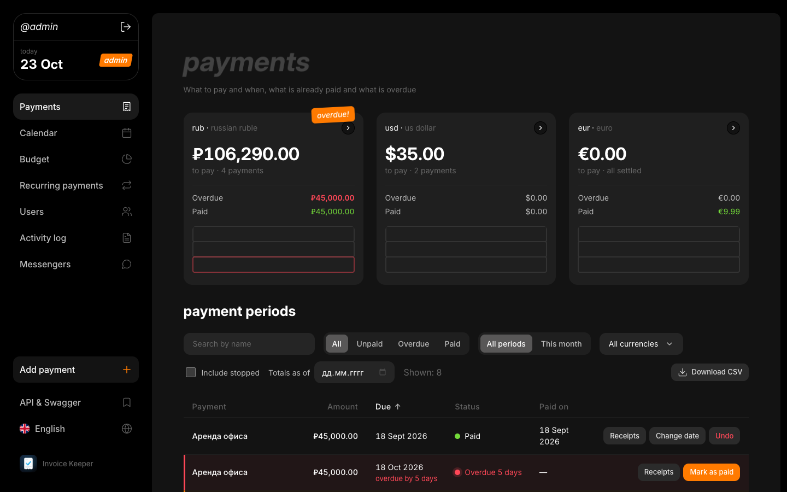
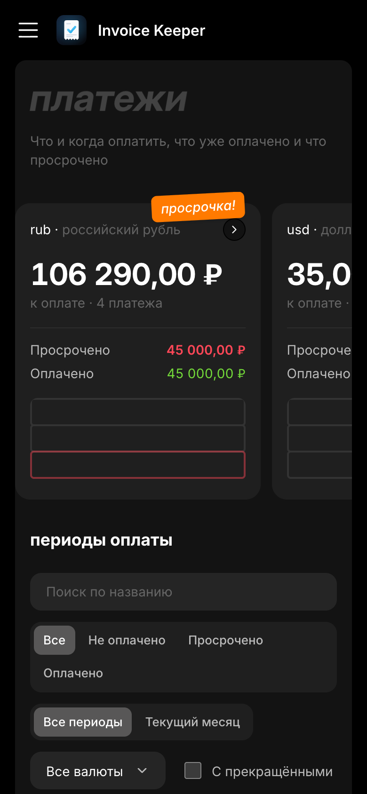

<p align="center">
  
  
</p>

# Invoice Keeper

[](https://github.com/LerkOFF/invoice-keeper/actions/workflows/tests.yml)

Сервис напоминаний о регулярных платежах: аренда, подписки, серверы и другие периодические расходы.
Кейс хакатона Aeza РнД, уровень Middle.

Администратор вносит платежи, бот за 3 дня до срока пишет в Telegram-чат и/или в MAX, команда отмечает оплату
в веб-панели. В любой момент видно: что и когда оплатить, что уже оплачено и что просрочено.



## Быстрый старт

Нужны Docker и Docker Compose v2.24 или новее (`docker compose version`). Больше ничего не требуется.

```bash
git clone https://github.com/LerkOFF/invoice-keeper.git
cd invoice-keeper
cp .env.example .env
docker compose up --build
```

Через минуту всё готово:

- **Панель:** http://localhost:8000
- **Swagger:** http://localhost:8000/api/v1/docs
- **OpenAPI-файл:** [openapi.yaml](openapi.yaml)

Остановка: `Ctrl+C`, затем `docker compose down`. Данные лежат в Docker volume `invoice_data`
и переживают перезапуск, полностью очистить их можно командой `docker compose down -v`.

### Учётные записи

При первом запуске подгружаются **тестовые данные**: аренда в рублях, сервер в долларах, подписка в евро
(у аренды есть оплаченный период, просроченный и будущий), годовое продление домена и обычный пользователь.

| Роль | Логин | Пароль | Откуда |
| --- | --- | --- | --- |
| Администратор | `admin` | `change-me` | `ADMIN_LOGIN`, `ADMIN_PASSWORD` в `.env` |
| Пользователь | `user` | `user-pass-123` | `SEED_USER_LOGIN`, `SEED_USER_PASSWORD` в `.env` |

Администратор задаётся только в `.env`, через панель и API его создать, изменить или удалить нельзя.
Перед настоящим использованием поменяйте `ADMIN_PASSWORD`, при значении по умолчанию в логе будет предупреждение.
Тестовые данные отключаются через `SEED_DEMO_DATA=false`.

## Telegram-напоминания

Без настройки приложение работает целиком, но напоминания не отправляет и пишет об этом в лог.

1. Создайте бота у `@BotFather`, токен положите в `TELEGRAM_BOT_TOKEN`.
2. Добавьте бота в нужный чат или группу и напишите там любое сообщение.
3. Узнайте id чата: откройте `https://api.telegram.org/bot<TOKEN>/getUpdates`, возьмите `message.chat.id`
   (у групп он отрицательный) и положите в `TELEGRAM_CHAT_ID`.
4. Перезапустите: `docker compose up -d`.

Бот проверяет сроки при старте и раз в минуту. Минимум за 3 дня до срока он присылает название, сумму,
валюту и дату оплаты, по одному разу на период. Платёж, добавленный позже, получает напоминание сразу.
Если срок прошёл, а оплату так и не отметили, на следующий день приходит одно повторное напоминание «Платёж просрочен»
(отключается `OVERDUE_REMINDERS=false`). Оплаченные и удалённые платежи молчат. Если Telegram недоступен, напоминание не теряется и уходит позже ровно один раз.

### Кнопка «Оплачено» в сообщении

В каждом напоминании есть кнопка **✅ Оплачено**. Нажатие отмечает период оплаченным сегодняшней датой (так же, как в панели),
сообщение обновляется («Оплачено 23.10.2026, отметил(а): @ivan») и кнопка исчезает. Повторное нажатие безвредно.

- **Кто может нажимать:** только участники чата, в который приходят напоминания. Участие проверяется через `getChatMember`.
  Чтобы Telegram разрешал боту такую проверку, **сделайте бота администратором чата**. Если проверить не удалось, кнопка отказывает.
- **Сузить круг:** `TELEGRAM_ALLOWED_USER_IDS=123456789,987654321`, тогда нажимать смогут только эти люди и только будучи участниками чата.
  Свой id показывает, например, `@userinfobot`.
- Кнопки из других чатов игнорируются, посторонний видит отказ и ничего не меняет.
- Работает через long polling (`getUpdates`): публичный адрес и webhook не нужны. Если у бота уже включён webhook,
  Telegram ответит `Conflict`, в логе будет подсказка. Отключить кнопку: `TELEGRAM_BUTTONS_ENABLED=false`.

## Напоминания в MAX

Бот MAX делает то же, что Telegram-бот: присылает напоминания с кнопкой **✅ Оплачено**, а нажатие отмечает период оплаченным.
Каналы независимы: можно включить один MAX, один Telegram или оба сразу, напоминание придёт в каждый ровно один раз.

1. Создайте бота на [платформе MAX для бизнеса](https://business.max.ru/self) (раздел «Чат-боты», нужен верифицированный профиль)
   и положите токен в `MAX_BOT_TOKEN`.
2. Добавьте бота в групповой чат и **сделайте администратором**: без этого MAX не присылает боту нажатия кнопок.
   Для личных напоминаний вместо группы откройте диалог с ботом и нажмите «Начать».
3. Напишите в чате любое сообщение и узнайте id чата:
   `docker compose exec app python -m app.services.max_api` напечатает строки вида `MAX_CHAT_ID=-71234567890123`.
   Положите значение в `MAX_CHAT_ID`.
4. Перезапустите: `docker compose up -d`.

- **Кто может нажимать:** участники чата (проверка `GET /chats/{id}/members`, кэш на минуту), в диалоге с ботом его собеседник.
  `MAX_ALLOWED_USER_IDS=123,456` сужает круг. Ошибка проверки означает отказ.
- Нажатия принимаются long polling (`GET /updates`), публичный адрес не нужен. Если боту включён webhook, `/updates` пуст:
  снимите подписку `DELETE /subscriptions`. Отключить кнопку: `MAX_BUTTONS_ENABLED=false`.
- API MAX подписан сертификатом Минцифры. Он лежит в [app/certs/](app/certs/) и подключается только к запросам в MAX,
  в систему ничего ставить не нужно.

### Команды бота

В Telegram и MAX бот отвечает на команды (в Telegram они есть в меню бота):

- `/todo` — что оплатить в ближайшие 7 дней и что уже просрочено, с итогом по каждой валюте;
- `/overdue` — только просроченные платежи;
- `/help` — справка.

Списки видны только в чате напоминаний и в личке у пользователей, которые привязали мессенджер в панели.
Постороннему бот отвечает, что доступа нет, в чужих группах молчит. Команды только читают данные.

## Что ещё умеет

- **Оформление как у кабинета aeza**: тёмная тема, сайдбар, плитки итогов и анимации my.aeza.ru.
- **Русский и английский**: язык переключается в сайдбаре (и на экране входа) и запоминается в браузере.
- **Защита входа**: после 5 неверных паролей подряд с одного адреса этот логин закрыт на 15 минут (ответ 429),
  блокировка видна в журнале. Чужой перебор не мешает войти настоящему пользователю с его адреса.
- **Журнал** (вкладка «Журнал», `GET /api/v1/audit-log`, только админ): входы и неудачные попытки, оплаты
  (в том числе из Telegram и MAX), изменения платежей, пользователей и чеков, отправленные напоминания. Пароли туда не попадают.
- **Календарь оплат** (вкладка «Календарь»): платежи месяца по дням, будущие месяцы считаются по правилу повторения.
- **Бюджет** (вкладка «Бюджет»): плановые расходы на год и по месяцам, отдельно по каждой валюте, оплачено и остаток.
- **Поиск и сортировка**: поле «Поиск по названию» над таблицей платежей (`q` в `GET /payment-occurrences` и в выгрузке),
  щелчок по заголовку столбца сортирует по названию, сумме, сроку, статусу или дате оплаты.
- **Выгрузка в CSV**: кнопка «Скачать CSV» во вкладке «Платежи» или `GET /api/v1/payment-occurrences/export`
  с теми же фильтрами, что у списка. Файл открывается в Excel без настройки: разделитель `;`, запятая в суммах, кириллица.
- **Итоги на дату**: поле «Итоги на дату» во вкладке «Платежи» или `GET /api/v1/payments/summary?on=2026-09-30`.
- **Чеки и ссылки**: кнопка «Чеки» у периода. Можно прикрепить ссылку или файл (PDF, PNG, JPEG, WebP до 5 МБ).
- **Email**: задайте `SMTP_HOST`, `SMTP_FROM` и `SMTP_TO` (плюс логин и пароль), и напоминания будут приходить письмом.
  Для Яндекса: `smtp.yandex.ru`, порт `465`, `SMTP_SECURITY=ssl`, пароль приложения.
- **Привязка мессенджеров** (вкладка «Мессенджеры», `/api/v1/me/messengers`): каждый пользователь привязывает свой Telegram и MAX
  одноразовой ссылкой на бота. После этого напоминания приходят ему лично, с кнопкой «Оплачено», а отметка из мессенджера
  записывается в журнал от имени пользователя панели. Общий чат продолжает работать.
- **Webhook**: задайте `WEBHOOK_URL`, и напоминания (`reminder.due`, повторное `reminder.overdue`) и события журнала будут уходить POST-запросом с JSON.
  С `WEBHOOK_SECRET` у запроса будет подпись `X-Invoice-Keeper-Signature: sha256=<HMAC-SHA256 тела>`.
  Поля `text` и `content` подходят для входящих webhook Slack, Mattermost и Discord: адрес такого webhook можно указать напрямую.

## Скриншоты

Сняты на тестовых данных из `SEED_DEMO_DATA`.

<table>
  <tr>
    <td width="50%"><br>Календарь: сроки по дням, будущие месяцы по правилу повторения</td>
    <td width="50%"><br>Бюджет на год и по месяцам, отдельно по каждой валюте</td>
  </tr>
  <tr>
    <td><br>Правка платежа: новая сумма не переписывает историю</td>
    <td><br>Журнал входов и действий, только для админа</td>
  </tr>
  <tr>
    <td><br>Интерфейс на английском, переключатель в боковой панели</td>
    <td align="center"><br>На телефоне</td>
  </tr>
</table>

## Проверка за минуту

Скрипт проходит весь сценарий демонстрации и проверяет каждый шаг (нужен только Python 3.9+):

```bash
python3 scripts/demo.py
```

Он входит администратором и пользователем, добавляет платёж, ждёт напоминание, отмечает оплату, показывает
просрочку, исправляет фактическую дату и проверяет, что следующий период живёт со своим статусом.
Если пароль администратора изменён: `python3 scripts/demo.py --admin-password '...'`.
Напоминание он засчитывает, когда у периода появился `reminded_at`, то есть когда Telegram настроен.

## Сценарий демонстрации в панели

1. Войти как `admin`.
2. «Регулярные платежи», добавить платёж, например «Хостинг», 990, USD, срок через 2 дня.
3. В Telegram придёт напоминание.
4. Выйти, войти как `user`, в «Платежи» нажать «Отметить оплату».
5. Показать просроченный платёж: у тестовой аренды он подсвечен красным, внизу итоги по валютам.
6. «Изменить дату» у позже оплаченного периода: после исправления просрочка исчезает, срок не меняется.
7. У аренды виден следующий период со своим статусом, прошлые оплаты сохранены.

## Правила учёта

- **Периодичность:** ежемесячно, раз в квартал или раз в год (`period`: `monthly`, `quarterly`, `yearly`).
  Даты считаются от даты первой оплаты: ежемесячный платёж от 31 января придёт 28 февраля и снова 31 марта,
  годовой от 29 февраля придёт 28 февраля в невисокосный год. Ближайший срок виден в списке сразу, даже если до него полгода.
- **Периоды:** у каждого своя дата и своя отметка «Оплачено / Не оплачено». Новый период не стирает прошлые оплаты,
  просрочка не останавливает следующие периоды.
- **Просрочка** начинается со следующего дня после срока, оплата в день срока вовремя. Оплата позже срока тоже
  просрочка, а исправление фактической даты пересчитывает её (срок периода не меняется).
- **Роли.** Администратор добавляет и удаляет платежи, управляет пользователями и может всё, что пользователь.
  Пользователь смотрит список, отмечает и отменяет оплату, правит фактическую дату.
  Ограничения проверяются на сервере, поэтому действуют и в API.
- **Валюты:** RUB, USD, EUR, итоги считаются отдельно, без курсов и конвертации.
- **Правка** платежа (кнопка «Изменить», только админ): новая сумма действует для неоплаченных периодов с сегодняшнего дня,
  оплаченные и прошлые сохраняют свою, потому что сумма записана в каждом периоде. Новый график задаётся датой ближайшей
  оплаты: неоплаченные будущие сроки старого графика убираются, история остаётся. Валюта не меняется.
- **Удаление** платежа прекращает периоды и напоминания, история оплат остаётся.
- Часовой пояс единый, задаётся в `APP_TIMEZONE`. Нет такого числа в месяце: платёж выпадает на последний день.

## API

Все эндпоинты под `/api/v1`, полное описание в [openapi.yaml](openapi.yaml) и в Swagger.
Авторизация: `POST /auth/login` возвращает токен (его принимает `Authorization: Bearer <token>`) и ставит cookie для панели.

| Метод | Путь | Кто | Назначение |
| --- | --- | --- | --- |
| POST | `/auth/login` | все | вход по логину и паролю |
| GET | `/auth/me` | вошедшие | текущий пользователь |
| POST | `/auth/logout` | вошедшие | завершение текущей сессии |
| GET | `/recurring-payments` | вошедшие | список регулярных платежей |
| POST | `/recurring-payments` | админ | создание регулярного платежа |
| PATCH | `/recurring-payments/{id}` | админ | изменение названия, суммы и графика |
| DELETE | `/recurring-payments/{id}` | админ | прекращение платежа с сохранением истории |
| GET | `/payment-occurrences` | вошедшие | список периодов (оплаченные, просроченные, фильтры) |
| GET | `/payment-occurrences/export` | вошедшие | выгрузка периодов в CSV с фильтрами списка |
| GET | `/payment-occurrences/{id}` | вошедшие | конкретный период |
| PATCH | `/payment-occurrences/{id}` | вошедшие | подтверждение или отмена оплаты, исправление даты |
| GET | `/payments/summary` | вошедшие | итоги по валютам |
| GET | `/users` | админ | список пользователей |
| POST | `/users` | админ | создание обычного пользователя |
| PATCH | `/users/{id}` | админ | изменение логина и пароля |
| DELETE | `/users/{id}` | админ | удаление пользователя |
| GET | `/docs` | все | Swagger-документация |

## Настройки

Всё задаётся в `.env` (шаблон без секретов: [.env.example](.env.example)).

| Переменная | По умолчанию | Смысл |
| --- | --- | --- |
| `ADMIN_LOGIN`, `ADMIN_PASSWORD` | `admin`, `change-me` | единственный администратор |
| `TELEGRAM_BOT_TOKEN`, `TELEGRAM_CHAT_ID` | пусто | куда слать напоминания |
| `APP_TIMEZONE` | `Europe/Moscow` | часовой пояс для «сегодня» |
| `REMINDER_DAYS` | `3` | за сколько дней до срока напоминать |
| `OVERDUE_REMINDERS` | `true` | одно повторное напоминание на следующий день после срока, если не оплачено |
| `TELEGRAM_BUTTONS_ENABLED` | `true` | кнопка «Оплачено» в напоминаниях |
| `TELEGRAM_ALLOWED_USER_IDS` | пусто | сузить круг нажимающих до списка Telegram id |
| `MAX_BOT_TOKEN`, `MAX_CHAT_ID` | пусто | бот MAX и чат для напоминаний |
| `MAX_BUTTONS_ENABLED`, `MAX_ALLOWED_USER_IDS` | `true`, пусто | кнопка «Оплачено» в MAX и список допущенных id |
| `SMTP_HOST`, `SMTP_PORT`, `SMTP_SECURITY` | пусто, `465`, `ssl` | почтовый сервер для писем |
| `SMTP_USER`, `SMTP_PASSWORD`, `SMTP_FROM`, `SMTP_TO` | пусто | ящик отправителя и получатели через запятую |
| `WEBHOOK_URL`, `WEBHOOK_SECRET` | пусто | webhook для напоминаний и событий, секрет подписи |
| `WEBHOOK_EVENTS` | `payment.,occurrence.,receipt.,user.` | какие события журнала отправлять |
| `RECEIPT_MAX_MB`, `RECEIPTS_PER_PERIOD` | `5`, `10` | лимиты чеков |
| `SCHEDULER_INTERVAL_SECONDS` | `60` | как часто проверять сроки |
| `SESSION_TTL_HOURS` | `12` | срок жизни сессии |
| `LOGIN_MAX_FAILURES`, `LOGIN_LOCK_MINUTES` | `5`, `15` | защита входа от перебора паролей |
| `COOKIE_SECURE` | `false` | включить за HTTPS |
| `SEED_DEMO_DATA`, `SEED_USER_*` | `true`, `user` | тестовые данные и демо-пользователь |

## Разработка и тесты

```bash
python3 -m venv .venv && .venv/bin/pip install -r requirements-dev.txt
.venv/bin/pytest                                   # ~335 тестов
.venv/bin/uvicorn app.main:app --reload            # без Docker, база в ./data
.venv/bin/python scripts/export_openapi.py         # пересобрать openapi.yaml
```

Тест `tests/test_openapi.py` падает, если `openapi.yaml` разошёлся с кодом.

На каждый пуш GitHub Actions ([.github/workflows/tests.yml](.github/workflows/tests.yml)) гоняет тесты, сверяет `openapi.yaml`,
поднимает приложение по README в Docker, проходит сценарий демо и проверяет, что данные переживают перезапуск.

```
app/
  api/         роутеры /api/v1 и зависимости (роли)
  core/        настройки, база, пароли, время
  models/      модели SQLAlchemy
  services/    периоды, просрочка, пользователи, напоминания, Telegram, MAX
  certs/       сертификат Минцифры для API MAX
  scheduler.py фоновая проверка сроков
  web/         панель (index.html, static/)
scripts/       demo.py, export_openapi.py
tests/         pytest
docs/          план работ и архитектура
```

## Если что-то не так

- **Ошибка про `env_file` или `required`:** обновите Docker Compose до v2.24+ или просто выполните `cp .env.example .env`.
- **Порт 8000 занят:** добавьте в `.env` строку `APP_PORT=8001` (или другой свободный порт) и перезапустите.
- **Напоминания не приходят:** проверьте `TELEGRAM_BOT_TOKEN` и `TELEGRAM_CHAT_ID` (или `MAX_BOT_TOKEN` и `MAX_CHAT_ID`),
  бот должен быть в чате и иметь право писать.
  Причина видна в логе: `docker compose logs app`.
- **Забыли пароль администратора:** он лежит в `.env`, поменяйте и выполните `docker compose up -d`.
- **Хочу чистую базу:** `docker compose down -v`, затем снова `docker compose up --build`.

## Документация

- [План работ и чек-лист](docs/PLAN.md)
- [Архитектура и правила предметной области](docs/ARCHITECTURE.md)

## Фирменный стиль

Файлы в `app/web/static/brand/`: знак `logo-mark.svg` (плитка со скруглением), `logo-square.svg` (без скругления, для круглых и квадратных аватаров),
`logo-glyph.svg` (одноцветный знак без плитки), горизонтальные `logo-horizontal-light.svg` и `logo-horizontal-dark.svg`, `favicon.svg`,
PNG для сайта (`favicon-32`, `apple-touch-icon`, `icon-192`, `icon-512`), `og-image.png` (карточка 1200×630 для ссылок) и `bot-avatar.png` (640×640).

Аватар бота ставится вручную в @BotFather: `/setuserpic`, выбрать бота, отправить `bot-avatar.png`. Описание: `/setdescription`.
Цвета: фон знака `#05070a`, акцент `#0ea5e9` (светлее `#7dd3fc`), бумага `#f8fafc`.
